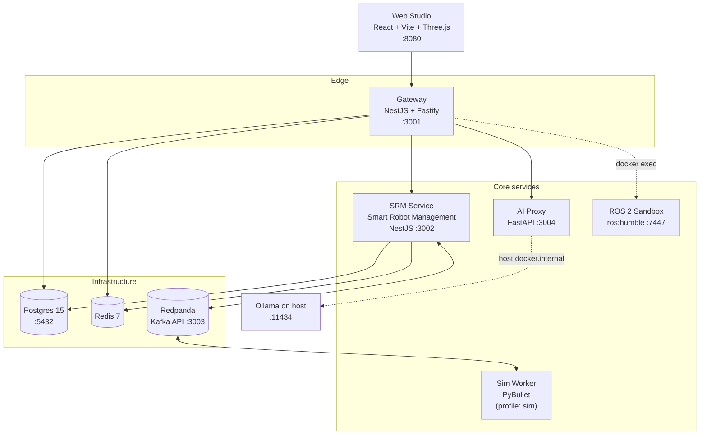

# Vanika AI

A conversational robotics platform. Describe a robot in natural language and Vanika generates its URDF/SDF description, renders it in a 3D browser studio, generates ROS 2 code for it, simulates it in PyBullet, and manages the resulting fleet — firmware rollouts, commands, and telemetry included.

The system is a polyglot monorepo: a React studio, two NestJS services, a Python AI proxy, a Python simulation worker, and a ROS 2 sandbox container, wired together over Postgres, Redis, and Kafka.

---

## Table of contents

- [Architecture](#architecture)
- [Repository layout](#repository-layout)
- [Quick start (Docker)](#quick-start-docker)
- [Environment configuration](#environment-configuration)
- [Service reference](#service-reference)
- [Local development](#local-development)
- [Database and migrations](#database-and-migrations)
- [AI model routing](#ai-model-routing)
- [Testing](#testing)
- [Troubleshooting](#troubleshooting)
- [Known issues](#known-issues)

---

## Architecture

> A fuller account — how a request flows, how tenant isolation actually works,
> how bring-your-own-key and the repair engine fit together, and what is not
> finished — is in **[ARCHITECTURE.md](ARCHITECTURE.md)**.



**Request path.** The browser talks only to the Gateway. The Gateway authenticates the caller against Supabase JWKS, resolves the organisation context, and then either serves the request itself (auth, orgs, projects, terminal) or forwards it — `/v1/srm/*` is proxied to the SRM service, `/v1/ai/converse` to the AI proxy.

**Robot generation.** A prompt reaching the AI proxy is classified into a route, answered by the matching model, and returned as a typed *intent* — `robot_bundle`, `cad_part`, `update_robot`, `patch`, `code`, `action`, or `reply`. A `robot_bundle` carries both raw URDF XML and a parallel structured `robot_spec` (links, joints, embedded meshes, total mass). That shared bundle is the contract binding AI generation, the browser's URDF viewer, and the PyBullet worker together.

**Simulation.** SRM publishes jobs to the `sim-jobs` Kafka topic. The sim worker consumes one job at a time, runs the scenario headlessly, and publishes to `sim-results`, which SRM consumes back to update run status.

**Live updates.** Two consumers need SRM's event stream over different transports, so `EVENT_BUS_TRANSPORT=kafka` fans out rather than switching wholesale:

| Stream | Transport | Consumer |
|---|---|---|
| `sim-jobs` / `sim-results` | Kafka only | `sim-worker` speaks Kafka exclusively |
| `srm:changes:*` | Kafka **and** Redis | Gateway realtime bridge is Redis-only (`PSUBSCRIBE srm:changes:*`) |

Kafka is the source of truth and is published first; the Redis fan-out is best-effort, so a pub/sub outage cannot fail a write that already committed to Kafka. The Gateway relays what it receives to the browser over Socket.IO.

---

## Repository layout

```
VanikaAi/
├── apps/
│   └── web/                  React studio — chat, URDF canvas, code panel, terminal
├── services/
│   ├── gateway/              NestJS BFF: auth, orgs, projects, proxying, terminal
│   │   ├── Dockerfile        Multi-service stack image
│   │   ├── Dockerfile.sandbox  ROS 2 Humble sandbox
│   │   └── prisma/           Org / User / Membership / Project / Thread
│   ├── srm-service/          NestJS domain service (Smart Robot Management)
│   │   └── prisma/           Robot / SrmVersion / SimRun / Fleet* / Telemetry
│   ├── ai-proxy/             FastAPI — LLM routing, URDF/SDF/CAD generation
│   │   └── evals/            Prompt-tuning corpus and runner
│   └── sim-worker/           PyBullet simulation consumer (Kafka)
├── docker-compose.yml        Full local stack
└── .env.docker.example       Template for required secrets
```

---

## Install it in one command

From a clean machine to a browser tab, on any supported platform. The installer
checks what is already there, installs only what is missing, generates its own
secrets, waits for every service to answer, and opens the app.

```powershell
# Windows
powershell -ExecutionPolicy Bypass -File .\install.ps1
```

```bash
# macOS, Ubuntu, Debian, Fedora, Arch, openSUSE, Alpine
./install.sh

# a server, unattended
./install.sh --yes --no-browser

# diagnose and fix an existing install
./install.sh --repair
```

Re-running is safe and is also how you update: nothing already correct is
reinstalled, and `.env.docker` is never overwritten. Kubernetes, AWS, Azure and
GCP are covered in [deploy/README.md](deploy/README.md).

**On Windows the installer also tunes WSL2**, which is the difference between
`VmmemWSL` sitting at a gigabyte and creeping past ten. See
[why WSL2 shows so much memory](deploy/README.md#why-wsl2-shows-so-much-memory-on-windows-and-what-to-do).

---

## Quick start (Docker)

### Prerequisites

| Requirement | Notes |
|---|---|
| Docker Desktop | Compose v2+. The stack builds 5 images (6 with the `sim` profile) and pulls 3 more. The ROS 2 sandbox and the CAD kernel are large, so allow ~10 GB disk and 20–30 min on a cold build. |
| Supabase project | Supplies auth. The Gateway will not start without valid JWKS settings. |
| At least one LLM key | `MISTRAL_API_KEY` covers the default path; see [AI model routing](#ai-model-routing). |
| Ollama *(optional)* | Runs on the **host**, not in Docker. Start with `ollama serve`. |

### Run it

```bash
# 1. Create your secrets file from the template
cp .env.docker.example .env.docker
#    then edit .env.docker and fill in the values

# 2. Build and start the stack
docker compose up --build

# 3. Optionally include the simulation worker
docker compose --profile sim up --build
```

The Gateway and SRM containers each run `prisma migrate deploy` on startup, so the database schema is applied automatically on first boot. The Gateway additionally applies its row-level-security policies.

### What it costs to run

Measured on a live stack, idle:

| Service | Memory | Ceiling |
|---|---|---|
| Redpanda (Kafka) | 304 MB | 1400 MB |
| AI proxy | 124 MB | 768 MB |
| Postgres | 121 MB | 1 GB |
| Gateway | 113 MB | 768 MB |
| SRM service | 111 MB | 768 MB |
| ROS 2 sandbox | 43 MB | 2 GB |
| Sim worker | 37 MB | 1500 MB |
| Socket proxy | 23 MB | 128 MB |
| Frontend | 19 MB | 128 MB |
| Redis | 16 MB | 256 MB |

**About 900 MB in total.** Every service carries a ceiling several times its
steady state, so one runaway process cannot take the machine — the failure
Redpanda produced before it was capped.

If Docker or WSL appears to be using far more than this, it is almost certainly
build cache rather than the application: `docker system df` will show it, and
`docker builder prune -af` reclaims it.

### Verify

```bash
docker compose ps                       # every service should be Up
curl http://localhost:3001/v1/health    # gateway  -> {"status":"ok"}
curl http://localhost:3002/health       # srm      -> {"status":"ok",...}
curl http://localhost:3004/health       # ai-proxy -> {"status":"ok"}
```

Then open **http://localhost:8080**.

### Stop it

```bash
docker compose down          # stop, keep the database volume
docker compose down -v       # stop and delete Postgres data
```

---

## Environment configuration

All Docker services read the single `.env.docker` file at the repo root. It is git-ignored — never commit it.

### Required

| Variable | Used by | Purpose |
|---|---|---|
| `SUPABASE_URL` | gateway, srm, ai-proxy | Supabase project URL |
| `SUPABASE_SERVICE_ROLE_KEY` | gateway, srm | Server-side Supabase access |
| `SUPABASE_JWT_JWKS_URL` / `SUPABASE_JWKS_URL` | gateway, srm, ai-proxy | JWKS endpoint for verifying bearer tokens |
| `SUPABASE_JWT_ISSUER` / `SUPABASE_ISSUER` | gateway, srm, ai-proxy | Expected JWT issuer |
| `ANTHROPIC_API_KEY` | gateway, ai-proxy | Required for Gateway startup; backs the debugging route |

### Model providers

| Variable | Purpose |
|---|---|
| `MISTRAL_API_KEY` | Conversation route (default model) |
| `MISTRAL_ONLY` | `true` collapses every route onto Mistral — the cheapest way to boot |
| `GROQ_API_KEY` | Llama-based route classifier |
| `MOONSHOT_API_KEY` | Kimi model for the coding route |
| `OPENAI_API_KEY` | OpenAI-compatible endpoints |
| `OLLAMA_BASE_URL` | Defaults to `http://host.docker.internal:11434/v1` |
| `OLLAMA_MODEL` | Defaults to `qwen3:4b` |
| `OLLAMA_DEFAULT` / `OLLAMA_FOR_CODING` | Route Ollama into the default / coding paths |

### Networking

| Variable | Default |
|---|---|
| `CORS_ORIGIN` | `http://localhost:5173` |
| `CORS_ORIGINS` | `http://localhost:5173,http://localhost:8080` |
| `VITE_GATEWAY_BACKEND_URL` | `http://localhost:3001` — baked into the frontend at **build** time |
| `INTERNAL_API_KEY` | Shared secret for service-to-service calls |

> `VITE_GATEWAY_BACKEND_URL` is a Docker **build argument**. Changing it requires
> `docker compose up --build frontend`, not just a restart.

---

## Service reference

| Service | Host port | Container port | API docs | Stack |
|---|---|---|---|---|
| `frontend` | 8080 | 80 | — | React 18, Vite, Tailwind, nginx |
| `gateway-service` | 3001 | 3000 | `/docs` | NestJS + Fastify |
| `srm-service` | 3002 | 3001 | `/api/docs` | NestJS + Express |
| `ai-proxy` | 3004 | 3002 | `/docs` | FastAPI + Uvicorn |
| `kafka` | 3003 | 19092 | — | Redpanda v24.2.4 |
| `postgres` | 5432 | 5432 | — | Postgres 15 Alpine |
| `redis` | — | 6379 | — | Redis 7 Alpine |
| `ubuntu-sandbox` | 7447 | 7447 | — | ROS 2 Humble |
| `sim-worker` | 8003 | 8003 | `/docs` | Python + PyBullet *(profile `sim`)* |

Note the port shift: every backend service is published one number above its internal port.

### Gateway routes

| Prefix | Module |
|---|---|
| `/v1/auth` | Sign-up, sign-in, refresh, profile |
| `/v1/orgs` | Organisation creation and details |
| `/v1/projects` | Project CRUD |
| `/v1/projects/:projectId/workspace` | Terminal file operations (WebSocket + REST) |
| `/v1/ai/converse` | Forwarded to the AI proxy |
| `/v1/srm/*` | Catch-all proxy to the SRM service |

### SRM routes

Mounted under `/v1/srm`, grouped in Swagger as **Robots**, **Bill of Materials**, **Simulation**, **Code IDE**, and **Fleet**. Fleet splits into four controllers: robots, commands, firmware, and rollouts.

### Staged changes: how an agent edits a robot

An agent never writes to the robot model directly. It stages a proposal, and the
change applies only when a person approves it:

| Route | Purpose |
|---|---|
| `POST /v1/srm/:projectId/staged` | Propose a change. Nothing is written. |
| `GET /v1/srm/:projectId/staged` | The review queue, with a diff per entry. |
| `POST /v1/srm/:projectId/staged/:id/decision` | Approve (applies it) or reject (discards it). |
| `POST /v1/srm/:projectId/staged/:id/revert` | Undo an approved change, within 24 hours. |

This is the T2 tier from the agentic architecture document. The tier is defined
by what it costs to be wrong: a proposal the engineer can read and decline costs
one click, and rejecting has to leave the robot exactly as it was. That is only
true if the write never happened, which is why proposals live in their own table
rather than as a flag on the robot.

Four properties worth knowing:

- **The diff is recomputed on every read**, never stored. A diff frozen at
  proposal time would describe a robot that no longer exists, which is exactly
  the situation where an approve/reject decision goes wrong. An entry whose base
  version has been passed is marked `stale`, and the diff shown is against the
  current document.
- **Approving is an ordinary SRM write.** Same version bump, same history row,
  same change event on the realtime channel. Nothing downstream needs to know a
  change arrived through review.
- **Approving one proposal supersedes the others** for that robot. They were
  reasoned against a version that has now moved, so applying one afterwards
  would write a decision its author never saw. Superseded rows stay readable.
- **Revert replays the previous field values forward** as a new version with a
  `rollback` trigger, rather than restoring an old snapshot. Restoring a snapshot
  would silently discard unrelated edits made since. If something else has
  already overwritten those fields the revert refuses with a conflict, because
  undoing would then mean overwriting a change nobody reviewed.

Robot generation is deliberately outside this flow. Asking the copilot to build a
robot is a direct request whose result is previewed in the Studio before anything
is committed, so routing it through a second review would add a click without
adding a decision.

### Admin routes

All under `/v1/admin`, behind `AdminGuard` (organisation OWNER or ADMIN, or a
platform admin named in `PLATFORM_ADMIN_EMAILS`). Everything that changes state
is written to the audit log with actor, target and details.

| Route | Purpose |
|---|---|
| `GET /overview`, `/health` | Usage, spend and the last hour's signals |
| `GET /users`, `PATCH /users/:id/role`, `POST /users/invite` | Membership |
| `GET /users/:id/sessions`, `POST /users/:id/sessions/revoke` | Sign a person out everywhere |
| `GET /projects`, `GET /deleted-projects`, `POST /deleted-projects/:id/restore` | Projects, including recovery |
| `DELETE /deleted-projects/:id` | Purge for good; platform admin, audited, needs a fresh password |
| `GET /access` | The role and permission matrix the guards enforce |
| `GET /features`, `PUT /features/:key`, `PUT /features/:key/org/:orgId` | Capability switches |
| `GET /orgs`, `PATCH /orgs/:id/status`, `PATCH /orgs/:id/limits` | Suspend, reactivate, per-org AI ceiling |
| `GET /providers/catalogue`, `POST /providers/probe` | Bring your own key: templates, and testing a key before saving it |
| `GET|POST|PATCH|DELETE /providers`, `POST /providers/:id/test`, `GET /providers/:id/models` | Manage providers and list their live models |
| `GET /providers/routes`, `PUT /providers/routes/:task` | Route a task to your own provider and model |
| `GET /ai/routing`, `PUT /ai/routing/:task` | Platform routing: provider, service class, token cap, cache |
| `GET|POST /ai/evals` | The fixed, rule-scored model evaluation suite |
| `GET /ai/summary`, `/ai/events`, `/api/logs` (+ `.csv`) | Usage and request analytics |
| `GET /plans`, `/billing/orgs`, `PATCH /billing/orgs/:id/plan` | Plan tiers and assignment |
| `GET /audit`, `/sim/summary`, `/sim/runs`, `/system/now` | Audit, simulation analytics, host metrics |

### Everyone's routes

| Route | Purpose |
|---|---|
| `GET /v1/me/access` | What you are and what that lets you do |
| `GET /v1/me/sessions`, `POST /v1/me/sessions/revoke-others` | Where you are signed in |
| `GET /v1/features` | Which capabilities your organisation has |
| `POST /v1/ai/repair` | Diagnose a failed robot and get applicable repairs |

### Fleet device routes

The only paths reachable with a fleet token alone — a robot in the field has no
user session. Everything an operator does stays behind one.

| Route | Purpose |
|---|---|
| `POST /v1/device/fleet/whoami` | Confirm the identity the token carries |
| `POST /v1/device/fleet/telemetry` | Report a sample |
| `POST /v1/device/fleet/heartbeat` | Say the robot is alive |
| `POST /v1/device/fleet/commands/next` | Collect the next **approved** command |
| `POST /v1/device/fleet/commands/ack` | Acknowledge one |

### AI proxy routes

| Route | Auth | Purpose |
|---|---|---|
| `GET /health` | none | Liveness; probed by the container healthcheck |
| `GET /v1/cache/stats` | `x-internal-key` | Prompt cache counters and hit rate |
| `GET /v1/metrics` | `x-internal-key` | Per-route latency (p50/p95/p99), request and 5xx counts |
| `POST /v1/converse` | user JWT | Main entry point; set `stream: true` for SSE |
| `POST /v1/feedback` | user JWT | Thumbs up/down capture, feeding the eval corpus |
| `POST /v1/review` | `x-internal-key` | Generated-artifact review |

Compose publishes this service on host port 3004, so the two operational endpoints
sit behind `INTERNAL_API_KEY` rather than being open to anything that can reach the
host. Read them together — a latency rise on `/v1/converse` alongside a falling
cache hit rate is a different problem from one where the hit rate held steady:

```bash
curl -s -H "x-internal-key: $INTERNAL_API_KEY" localhost:3004/v1/metrics | jq .data.routes
```

`/v1/converse` latency is measured to first byte. For a streaming request that is
the wait before anything appears on screen, not the time the whole answer took.

### Measuring intent quality

Prompt changes are scored against `services/ai-proxy/evals/corpus.jsonl`, a
line-per-case file anyone can append a bad transcript to without writing Python:

```bash
python evals/run_evals.py --dry-run                    # validate the corpus, no API calls
ANTHROPIC_API_KEY=... python evals/run_evals.py        # score it
```

CI validates the corpus on every run and scores it on pushes to a long-lived
branch, failing below `--min-accuracy 0.85`. The floor is under 100% on purpose: a
live model missing one borderline phrasing is noise, while a prompt edit that drops
a third of the corpus is the regression the gate exists to catch.

---

## Local development

Docker is the supported path for running the whole system. Individual services can be run directly against the Compose infrastructure.

### Frontend

```bash
cd apps/web
pnpm install
pnpm dev            # http://localhost:5173
```

### Gateway (npm)

```bash
cd services/gateway
npm ci
npm run db:generate
npm run start:dev
```

### SRM service (pnpm)

```bash
cd services/srm-service
pnpm install
pnpm run db:generate
pnpm run start:dev
```

> Package managers differ per project and are not interchangeable: `apps/web` and
> `services/srm-service` use **pnpm** (`pnpm-lock.yaml`); `services/gateway` uses
> **npm** (`package-lock.json`).

### AI proxy

```bash
cd services/ai-proxy
pip install -r requirements.txt
uvicorn main:create_app --factory --reload --port 3002
```

### Sim worker

```bash
cd services/sim-worker
pip install -r requirements.txt
KAFKA_BROKERS=localhost:3003 python worker.py
```

---

## Database and migrations

Gateway and SRM **share one Postgres database** (`vanikadb` in Compose) while keeping separate Prisma schemas and migration folders. Their baseline migrations are deliberately named differently so both can be recorded in a single `_prisma_migrations` table.

**Apply Gateway migrations before SRM migrations.**

```bash
# Gateway
cd services/gateway
npm run db:migrate          # prisma migrate deploy
npm run db:rls              # row-level-security policies

# SRM
cd services/srm-service
pnpm run db:migrate         # prisma migrate deploy
```

Because the two schemas coexist, `prisma migrate dev` will report **drift** for the other service's tables. Use `db:migrate:deploy` to apply existing migrations, and `prisma migrate dev --create-only` when authoring new ones.

### Data model

| Gateway | SRM |
|---|---|
| `Org`, `User`, `Membership` | `Robot`, `SrmVersion`, `RosFile` |
| `Project`, `Thread` | `SimRun` |
| `IdempotencyKey` | `FleetRobot`, `FleetCommand`, `FleetCommandAudit` |
| | `FirmwareArtifact`, `FleetRollout`, `TelemetrySample` |

---

## AI model routing

The AI proxy classifies each message into a route and dispatches it to the model bound to that route.

| Route | Default provider | Override |
|---|---|---|
| `conversation` | Mistral | — |
| `coding` | Moonshot (Kimi, OpenAI-compatible) | `OLLAMA_FOR_CODING=true` |
| `debugging` | Anthropic Claude | — |

Classification itself runs on a Groq-hosted Llama model. Setting `MISTRAL_ONLY=true` collapses all three routes onto Mistral, which is the simplest way to get the stack running with a single API key.

A single `openai` client library serves both Groq and Moonshot, since both expose OpenAI-compatible endpoints.

### Prompt evals

`services/ai-proxy/evals/` holds the prompt-tuning harness — the instrument that makes prompt changes measurable rather than subjective.

```bash
cd services/ai-proxy
python evals/run_evals.py --dry-run    # validate the corpus compiles
python evals/run_evals.py              # score accuracy
```

Every thumbs-down becomes a permanent row in `corpus.jsonl`; the corpus only grows, which is what stops the prompt from regressing on cases it once passed. `tests/test_golden_intents.py` mirrors the corpus for CI gating.

---

## Testing

```bash
cd apps/web              && pnpm test        # vitest + coverage
cd services/gateway      && npm test         # jest + coverage
cd services/srm-service  && pnpm test        # jest
cd services/srm-service  && pnpm run test:e2e
cd services/ai-proxy     && pytest
cd services/sim-worker   && pytest
```

---

## Troubleshooting

**Gateway exits immediately on startup.**
It fails fast on missing required environment variables. Check `docker compose logs gateway-service` for the `Missing required env var:` line — `ANTHROPIC_API_KEY` and the Supabase settings are the usual culprits.

**Terminal features do nothing.**
The Gateway drives the terminal by running `docker exec` into the `vanika-ubuntu-sandbox` container through the mounted Docker socket. This is why the Gateway runs as `root` with `/var/run/docker.sock` bind-mounted. If the sandbox container is not running, the terminal silently has nothing to attach to.

**AI proxy cannot reach Ollama.**
Ollama is expected as a **host** install, not a container. Start it with `ollama serve` and confirm `host.docker.internal` resolves — on Linux this depends on the `extra_hosts: host-gateway` mapping already present in the Compose file.

**Frontend points at the wrong backend.**
`VITE_GATEWAY_BACKEND_URL` is compiled into the bundle at build time. Rebuild the image rather than restarting the container.

**`exec: ./docker-entrypoint.sh: not found` on Windows.**
The file is present — the shebang is not. A checkout with `core.autocrlf=true`
rewrites shell scripts to CRLF, so Linux reads the interpreter as `sh\r` and
reports the script itself as missing. The repository ships a `.gitattributes`
that pins `*.sh` to `eol=lf`; if you cloned before it existed, renormalize:

```bash
git add --renormalize .
# or fix the working tree directly:
find . -name "*.sh" -not -path "*/node_modules/*" -print0 | xargs -0 sed -i 's/\r$//'
docker compose up --build gateway-service srm-service
```

**Migration drift errors.**
Expected when Gateway and SRM share a database. See [Database and migrations](#database-and-migrations).

**Port already in use.**
The stack claims 8080, 5432, 3001, 3002, 3003, 3004, and 7447. A local Postgres on 5432 is the most common conflict.

---

## Known issues

### Fixed

Defects found while auditing the repository, and what was done about them:

- **🔴 Unauthenticated database-wipe endpoints.** `HealthController` exposed
  `POST /v1/health/clear-db`, **`GET /v1/health/clear-db`**, and `POST /v1/dev/clear-db`,
  each `@Public()` and each running `TRUNCATE TABLE ... CASCADE` over every tenant
  table. The `GET` variant meant any crawler, link preview, or browser prefetch
  could destroy all data with no credentials. The `GET` route is **removed** —
  destructive work must never sit behind a safe method — and the remaining POST
  routes now return `403` when `NODE_ENV=production`, unless `ALLOW_DEV_DB_RESET=true`
  is set as a deliberate opt-out for throwaway environments.
- **🔴 Live UI updates never reached the browser.** Under Compose's
  `EVENT_BUS_TRANSPORT=kafka`, `KafkaEventBus` published `srm:changes:*` only to the
  `srm-changes` topic, while the Gateway subscribes to Redis and has no Kafka client.
  Flipping to the Redis transport was not an option either — `sim-orchestration.ts`
  hard-requires Kafka because `sim-worker` only speaks Kafka. Added
  `KafkaRedisFanoutEventBus`, which publishes change events to **both** so simulation
  stays on Kafka and live updates work, with the Redis leg best-effort so an outage
  cannot fail an already-committed write.
- **Frontend could not build from a clean checkout.** `apps/web/Dockerfile` ran
  `npm ci` against `package-lock.json`, which is git-ignored there. Switched to pnpm
  against the committed `pnpm-lock.yaml`, matching `srm-service`.
- **`pnpm-lock.yaml` was stale**, missing `@xterm/xterm` and `@xterm/addon-fit`.
  Regenerated.
- **CRLF line endings broke both Node entrypoints.** With `core.autocrlf=true` and no
  `.gitattributes`, Linux read the shebang as `#!/bin/sh\r` and reported the *script*
  as missing. Added `.gitattributes` pinning `*.sh`, Dockerfiles, and container-bound
  config to `eol=lf`, and normalized the working tree.
- **SRM had no health endpoint** — `HealthController` and `HealthService` were empty
  stubs. Implemented `GET /health` as a dependency-free liveness probe.
- **Circular imports in the web fleet components.** `RobotItem` was defined in
  `FleetTab.tsx` and imported by `FleetRobotDetail.tsx` through the `../tabs` barrel,
  which re-exports `FleetTab` — a 3-file cycle plus a 4-file variant. Extracted the
  type into `tabs/fleet/types.ts`, a leaf module neither component can cycle back through.
- **`ai-proxy` declared `depends_on: postgres` but holds no database client.**
  Removed; it only delayed startup and misrepresented the topology.
- **`.env.docker.example` omitted `INTERNAL_API_KEY`**, which `ai-proxy` reads in
  `config/settings.py`. Added.

- **Form labels were not associated with their inputs.** `AuthLayout`'s `Field` rendered a
  `<label>` with no `htmlFor`, and the input was not nested inside it, so assistive tech
  announced every auth field as unlabelled. Wired `htmlFor`/`id` across all five fields;
  a Playwright test now asserts that clicking the label focuses the control.
- **`services/srm-service/README.md` replaced.** It was unmodified NestJS boilerplate;
  it now documents this service's modules, data model, event transports and commands.
- **The two per-service Compose files are now labelled** as standalone development stacks,
  with an explicit warning that they are not drop-in equivalents of the root stack.
- **`services/ai-proxy/evals/README.md` and `prisma/MIGRATIONS.md` corrected** — dead paths
  repointed, and the database name reconciled with what Compose actually provisions.
- **`build123d` and `cadquery-ocp` pinned together.** See the CAD note below.

### Outstanding

Two items, both decisions rather than defects.

- **The credentials in `.env.docker` are still live and still in git history.** The file was
  committed in `c2309c7` carrying a Supabase service-role key (which bypasses row-level
  security) plus five LLM provider keys. It is now untracked and ignored, so it cannot be
  committed again — but that does not undo the exposure. Rotation has been deliberately
  deferred; when it happens, start with the Supabase service-role key, then purge history with
  `git filter-repo` or BFG and regenerate `.gitleaks-baseline.json` (it should shrink to `[]`).
- **The app is desktop-only.** `App.tsx:145` hard-blocks viewports under 767px. A product
  decision, not a defect; the Playwright suite asserts the behaviour so it cannot change
  silently.

### Security posture

| Control | State |
|---|---|
| Dependency advisories | **0** across gateway, SRM, web and ai-proxy |
| Tenant isolation | **row-level security is enforced**: the gateway and SRM connect as `vanika_app`, an unprivileged role that cannot bypass a policy. Migrations and the platform admin keep the owner role. |
| Organisation roles | **enforced**: OWNER, ADMIN, ENGINEER and VIEWER map to twelve permissions, checked in the gateway and again in the SRM from the same table. A viewer can read and nothing else. |
| Dangerous admin actions | suspending an organisation, purging a project and deleting a plan require a password confirmation from the last ten minutes |
| Sessions | can be ended from the admin or by the user; a revoked session is refused within five seconds |
| Provider keys (BYOK) | encrypted at rest with AES-256-GCM; never returned to a client, only a masked hint |
| Fleet devices | authenticate with their own enrolment token on five narrow paths; the organisation, project and robot come from the token's record, never the request |
| Gateway process | runs as `vanika` (uid 1001), no Docker socket mounted |
| Docker access | via an allowlisting broker — container list + exec scoped to the sandbox by name; host-mount escape, image/volume/network access and exec into other containers all denied |
| Workspace file API | authenticated, with path containment on every filesystem call |
| CORS | validated against `CORS_ORIGINS`; unlisted origins receive no headers |
| Response headers | `X-Content-Type-Options`, `X-Frame-Options`, `Referrer-Policy` |
| Destructive dev endpoints | `GET` variant removed; `POST` gated on `NODE_ENV` |
| CAD executor | AST screen rejects traversal escapes; network removed from the child at runtime |
| CI gates | dependency audit (high+), secret scanning, all four test suites, Playwright |

### Recommended next steps

Ordered by value, none of them blocking.

1. **Rotate the exposed credentials** (see above). Everything else here is defence in depth
   around keys that are, today, still valid.
2. **Put the CAD executor behind real isolation.** The AST screen and the runtime network block
   raise the bar considerably, but `cad_part.py` still runs model-generated Python in an ordinary
   subprocess. gVisor, Firecracker, or a network-disabled container with cgroup limits is the
   right answer before this faces untrusted traffic.
3. **Enable branch protection** requiring the CI jobs in `.github/workflows/ci.yml`, so the
   audit and secret gates cannot be bypassed by merging around them.
4. **Add component-level frontend tests.** Unit coverage is 100% on the four pure modules under
   test, and Playwright covers routing, forms, responsiveness and accessibility end to end — but
   the fleet views and URDF studio have no component tests. This needs a DOM environment
   (`jsdom` + `@testing-library/react`), which is why it was not bundled into this pass.
5. **Consider `helmet` on the Gateway** for a fuller header set, and a Content-Security-Policy
   once the Swagger UI's inline-script requirements are worked out.
6. **Keep `build123d` and `cadquery-ocp` pinned together** — see the note below.

### Large assets and Git LFS

The robot mesh library is heavy: 223 MB across 11 blobs, the largest a 61 MB COLLADA
trunk mesh that trips GitHub's 50 MB warning on every push.

`.gitattributes` tracks `*.dae`, `*.stl`, `*.glb`, `*.fbx` and `*.node` through Git LFS,
but **forward-only** — the rules apply to newly added or modified files. The blobs
already in history are untouched, because rewriting them would change every commit hash
and stop this branch being a descendant of `main`.

Consequences worth knowing:

- Run `git lfs install` once after cloning, or any mesh added from now on checks out as a
  pointer file rather than geometry.
- CI fetches LFS objects in the `ai_proxy` job, whose build context carries the assets.
- GitHub will keep warning about the existing 61 MB blob until a full migration happens.
  That needs coordinating with everyone holding a clone, then:

  ```bash
  git lfs migrate import --include="*.dae,*.stl,*.node" --everything
  ```

  Every commit hash changes, so it is a deliberate, scheduled operation — not a fix to
  slip into a feature branch.

### A note on the CAD pins

`build123d==0.11.1` and `cadquery-ocp-novtk==7.9.3.1.1` must move together. Older build123d
(0.8 and below) called `TopoDS_Shape.HashCode`, which OCCT 7.8+ removed, so they had to pin
`cadquery-ocp==7.7.2`. That wheel was never published for linux/aarch64 on PyPI, so Apple
Silicon image builds fail. 0.11 replaced HashCode and depends on the headless `novtk`
package, which has cp312 manylinux aarch64 wheels. Do not let an unpinned resolve jump to
OCCT 8.

### Continuous integration

`.github/workflows/ci.yml` runs six independent jobs on every push and pull request:

| Job | Gate |
|---|---|
| `secrets` | gitleaks against full history, with a baseline for the known `.env.docker` exposure |
| `web` | typecheck, unit tests with coverage, `pnpm audit --audit-level high` |
| `gateway` | Prisma generate, build, tests, `npm audit --audit-level=high` |
| `srm` | Prisma generate, build, tests, `pnpm audit --audit-level high` |
| `ai_proxy` | pytest inside the image's `test` stage, plus `pip-audit` |
| `e2e` | Playwright against the built bundle, report uploaded on failure |
# vanika
